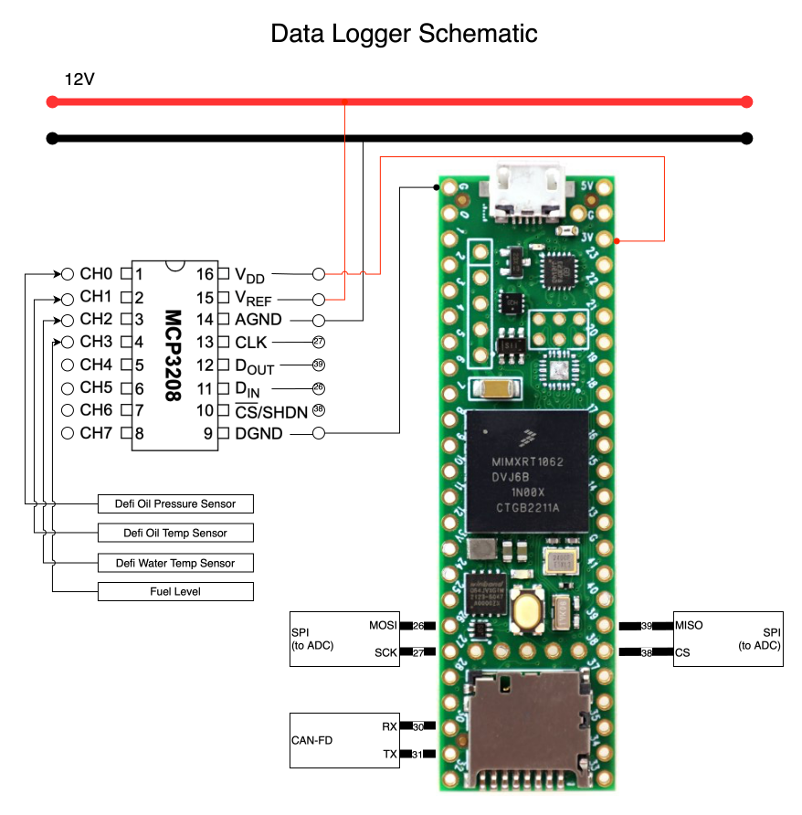

# TrackCAN : Data Logger Node

This node's main purpose is to listen on the can bus, and record vehicle data to sd card.
Its secondary purpose is to translate Defi sensor gauges and transmit classic messages



## SD card logging (TCAN-17)

The Teensy 4.1's microSD socket is described by Zephyr's board support (`usdhc1`, disk `SD`). The logger (`src/logger/sd_logger.c`)
runs in its own thread and writes every CAN frame this Node sends and receives to a new numbered file, `LOG0001.CSV`, `LOG0002.CSV`
and so on, one per start. It never overwrites a file and **never formats a card**. A missing or failing card never stops the rest of
the firmware: the logger retries every 2 s and recovers when a card is back.

- **Card:** FAT32 (exFAT and unformatted cards fail to mount and are left alone). Use a card of 32 GB or less.
- **Status LED** (the board LED, pin 13): slow blink = logging, fast blink = no card, steady on = the card or file system failed.
- **File format** (CSV, a header first, time in ms since power-up, no clock yet):

  ```
  t_ms,dir,id,dlc,data
  12345,TX,201,2,8401
  12360,RX,300,4,5585FF23
  1000,NOTE,,,dropped=12
  ```

  `dir` is TX or RX (this Node sent or received it) or NOTE (the logger's own messages, for example frames dropped because the queue
  was full). `data` is the payload in hex. Decode the signals afterwards with `can/trackcan.dbc`.
- **Power cuts:** data is written every 250 ms or 1 KB and the file is flushed to the card once a second, so a power cut loses
  about a second at most. A half-written last line is possible and is simply dropped when the file is read.
- **Console:** the Zephyr console is the LPUART6 pins (Teensy pins 0 and 1, 115200 baud) and needs a USB-serial adapter. The LED
  works without one.

Build and flash: `scripts/datalogger_build_flash.sh all` (the Teensy is flashed by its USB bootloader: press its program button when
asked). Host tests of the logic (format, file names, flush and sync policy):

```
cmake -S DataLogger_Node/tests -B build/datalogger_tests && cmake --build build/datalogger_tests && ctest --test-dir build/datalogger_tests --output-on-failure
```
